


**Física aplicada a productos que se pueden medir: visión por computador, modelos de riesgo y software que llega a producción.**

## Qué hago

Soy ingeniero físico (Universidad Andrés Bello). Me muevo entre tres mundos: **modelar** (ML, visión, estadística), **validar** (riesgo de crédito en banca) y **construir** (backend, web y herramientas). Co-fundé **[Fidelya](https://fidelya.cl)**, donde soy CSO; trabajo en visión computacional y ML en **[B&N Solutions](https://www.bnsolutions.cl)**, una consultora tecnológica, y como consultor de financiero en **Management Solutions**.

| | |
|---|---|
| 🔬 **Ciencia** | Visión por computador y ML aplicados a minería, asistencia y salud |
| 🏆 **Premio** | Ganador del **NASA International Space Apps Challenge 2026** con [NOVA](https://github.com/4mser/nova), un médico de a bordo para astronautas |
| 🏗️ **Infraestructura** | Visión por computador para inspeccionar túneles: detección de filtraciones con YOLO |
| 🏦 **Riesgo** | Validación de modelos de riesgo de crédito como consultor |
| 🚀 **Producto** | Fidelya: fidelización y retención con IA para locales físicos |

## Proyectos

<table>
<tr>
<td width="50%"><a href="https://github.com/xSempiternus/BermGuard"></a></td>
<td width="50%"></td>
</tr>
<tr>
<td width="50%"><a href="https://www.bnsolutions.cl/filtraciones-tuneles"></a></td>
<td width="50%"><a href="https://github.com/4mser/nova"></a></td>
</tr>
<tr>
<td width="50%"><a href="https://fidelya.cl">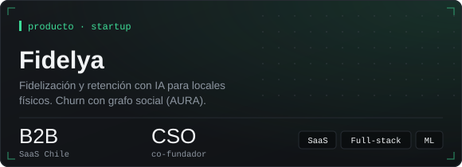</a></td>
<td width="50%"></td>
</tr>
</table>

> **FACUP Face ID** y **BermGuard** son los proyectos donde más medí. FACUP: 97.5% de acierto sin una sola falsa identificación en 735 verificaciones, comparando 4 modelos y 3 detectores. **BermGuard** destaca por cómo está medido: cifras con intervalos de confianza, umbral de operación explícito y decisiones corregidas con registro (ADR) cuando una medición mejor contradijo una anterior.

## Filtraciones en túneles: YOLO sobre cámaras de seguridad

Los túneles viales urbanos se filtran, y hoy se inspeccionan a ojo. Si el túnel ya tiene cámaras grabando las 24 horas, ¿por qué no enseñarles a mirar también las filtraciones? Entrené un detector YOLO con ejemplos etiquetados a mano, en tres niveles de severidad (leve, severa y crítica), y lo corrí sobre video real de cuatro tramos de túnel, uno de cada cinco cuadros. El resultado ya no es horas de video: es una lista ordenable con el minuto, la posición, la severidad y la confianza de cada detección.

<table>
<tr>
<td width="55%" align="center"> Detección sobre video real (vehículos difuminados y señalética recortada)</td>
<td width="45%" align="center">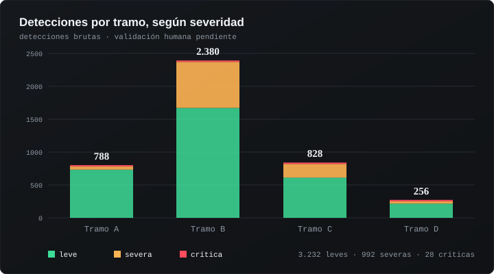 4.252 detecciones brutas en 4 tramos</td>
</tr>
</table>

- **76%** de las detecciones son humedad leve, **23%** severas y **menos del 1%** críticas: el filtro automático deja a la vista lo que un equipo de mantención debería revisar primero.
- Es un prototipo de investigación: las detecciones son brutas y **aún no se validan contra un conteo humano**, así que no declaro una precisión. Una misma filtración puede aparecer en varios cuadros.
- Lo escribí como artículo de divulgación en B&N Solutions: [Detección de filtraciones en túneles con YOLO](https://www.bnsolutions.cl/filtraciones-tuneles).

## Fidelya: fidelización e inteligencia de clientes

Co-fundé **[Fidelya](https://fidelya.cl)** y soy su CSO. Es una plataforma para locales gastronómicos: carta con QR, pedido desde la mesa, club de puntos, app para el equipo de sala y **AURA**, que recomienda a cada cliente lo que le gusta y trae de vuelta a los que dejaron de venir.

<table>
<tr>
<td width="32%" align="center" valign="top"> App de meseros (<a href="https://fidelya.cl">fidelya.cl</a>)</td>
<td width="68%" valign="top">

**Lo que diseñé y construí como CSO**

- **AURA Analytics:** un sistema MCP sobre LLMs locales (Ollama) que detecta clientes en riesgo de abandono y sugiere campañas.
- **Chatbot de postventa con RAG** para los dueños de locales.
- **Content Studio:** un orquestador que combina un LLM y una API de imágenes para producir reels y publicidad con el estilo visual de la marca.
- **Módulo de validación y QA** para monitorear sesiones y errores, y un generador de propuestas comerciales por rubro.
- **Mascota 3D en Blender** y videos promocionales con AMBAR Studio.

</td>
</tr>
</table>

## En acción

<table>
<tr>
<td width="50%" align="center"> <b>BermGuard</b> · pretil y proximidad entre equipos (videos generados con IA)</td>
<td width="50%" align="center">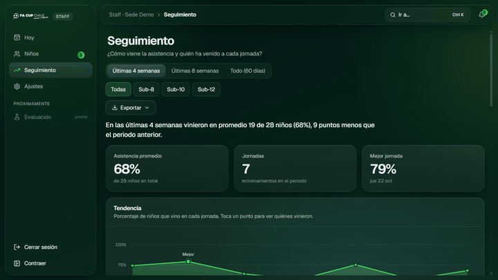 <b>FACUP</b> · panel del staff (sede demo, datos de prueba)</td>
</tr>
<tr>
<td width="50%" align="center"> <b>NOVA</b> · guía de RCP con realidad aumentada</td>
<td width="50%" align="center">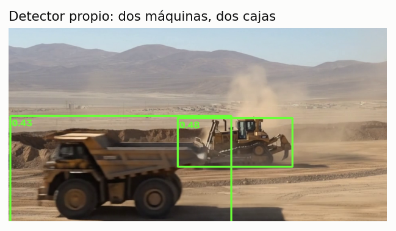 <b>BermGuard</b> · detector propio: dos máquinas, dos cajas (el modelo COCO las juntaba en una)</td>
</tr>
</table>

## Mi parte en NOVA: salud ocular con visión por computador

Diseñé el módulo que mira los ojos de la tripulación con la cámara del teléfono. Parte del Face Landmarker de Google (MediaPipe, 478 puntos con iris) y mide:

- la distancia margen-reflejo del párpado superior e inferior (MRD1 y MRD2, en versión normalizada por el diámetro del iris),
- cuántas veces y por cuánto tiempo parpadea la persona (parpadeo y PERCLOS),
- todo contra su propia línea base, y con abstención cuando la calidad de la imagen no alcanza.

Corre en CPU, con una mediana de ~8 ms por cuadro. Ahora lo estoy entrenando para detectar bostezos; esa parte es exploratoria. NOVA no es un dispositivo médico ni diagnostica: la salida es una alerta de seguimiento. El código está en un repositorio privado.

<table>
<tr>
<td width="50%">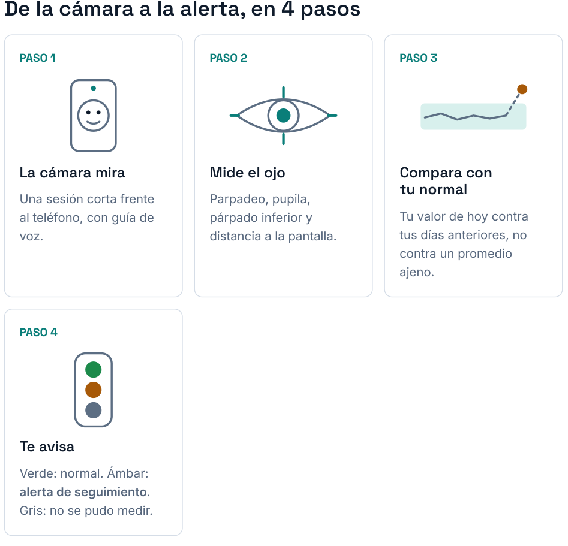</td>
<td width="50%"></td>
</tr>
</table>

## Trayectoria

| | |
|---|---|
| **2023** | Práctica en el Instituto Milenio SAPHIR: detector de partículas alpha con fibras ópticas |
| **2024** | Ingeniero de ML en VASCOLAB (YOLO para detectar filtraciones en túneles) y egreso de Ingeniería Física, UNAB |
| **Oct 2025** | Co-fundador y CSO de Fidelya; consultor de datos en riesgo de crédito |
| **2026** | Visión computacional y ML en B&N Solutions |
| **Nov 2026** | 🏆 Ganador del NASA International Space Apps Challenge con NOVA |

## Divulgación

Publiqué un artículo en [B&N Solutions](https://www.bnsolutions.cl/filtraciones-tuneles) sobre la detección de filtraciones en túneles. Tengo otros cuadernos de divulgación en preparación, aún sin publicar. Este es uno: **la flecha del tiempo**, con tres experimentos interactivos. En el primero, un gas simulado molécula por molécula llena un frasco y, al invertir el tiempo, cada molécula recorre su camino al revés y el gas vuelve al cuello, mientras la curva de entropía sube y baja.

 Borrador del cuaderno «La flecha del tiempo» · simulación basada en <a href="https://github.com/4mser/bn-lab-simulations">BN Lab Simulations</a> (MIT)

## Stack

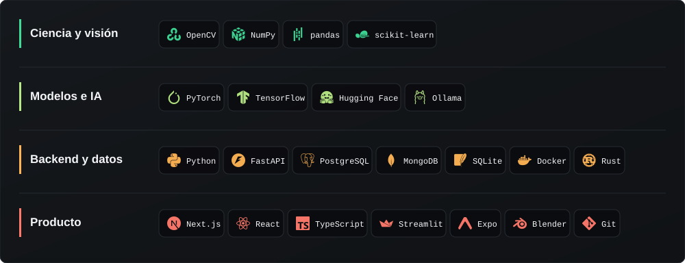

## Cómo encaja todo

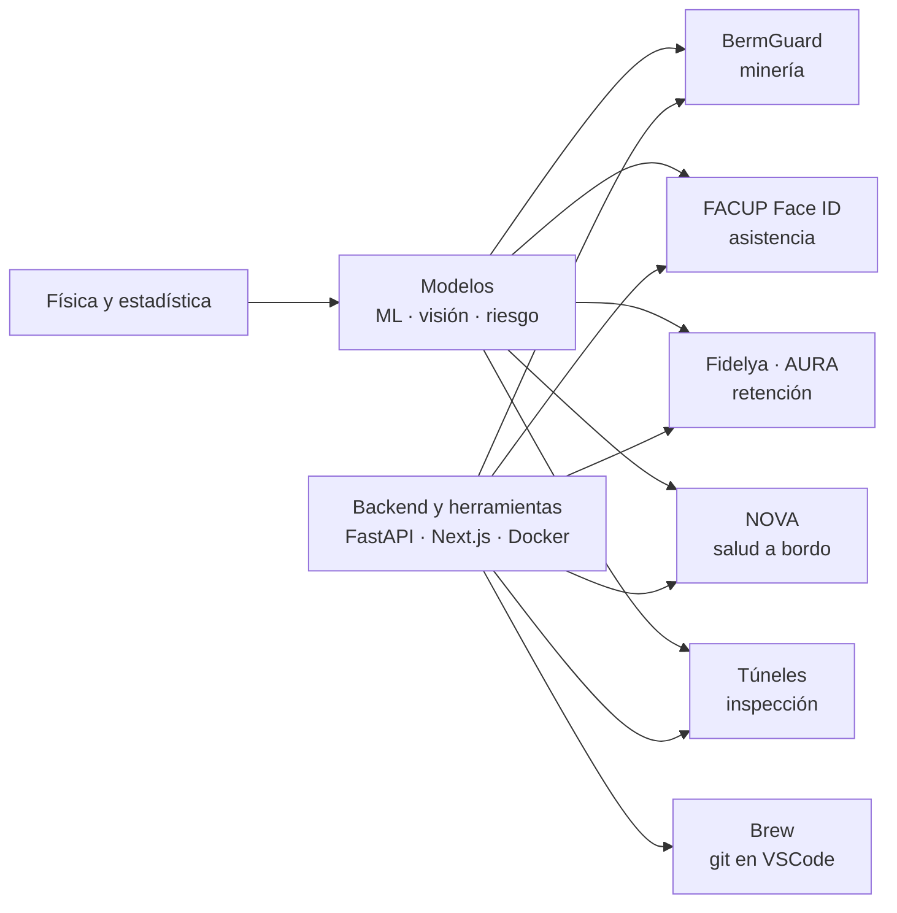

<b>🧪 Laboratorio: análisis y experimentos</b>

 

| Repo | Qué es |
|---|---|
| [`widget-git` (Brew)](https://github.com/xSempiternus/widget-git) | Widget de VSCode tipo cafetería para check, pull, commit y push de git |
| [`fastapi-sandbox`](https://github.com/xSempiternus/fastapi-sandbox) | Laboratorio de APIs REST con FastAPI, Pydantic y frontend |
| [`Exploratory-analisis-using-kmeans-of-instacart-data`](https://github.com/xSempiternus/Exploratory-analisis-using-kmeans-of-instacart-data) | Segmentación de clientes con k-means |
| [`Project1-PredictingBitcoinPrices`](https://github.com/xSempiternus/Project1-PredictingBitcoinPrices) | Predicción de precio con ML |
| [`climate-change-analysis.`](https://github.com/xSempiternus/climate-change-analysis.) | Análisis de cambio climático |
| [`Netflix-data-analysis`](https://github.com/xSempiternus/Netflix-data-analysis) | Análisis exploratorio de datos |
| [`voicecloning-linux`](https://github.com/xSempiternus/voicecloning-linux) | Clonación de voz en Linux |
| [`portafolio`](https://github.com/xSempiternus/portafolio) | Mi portafolio web |

**¿Hablamos?** &nbsp;·&nbsp; [B&N Solutions](https://www.bnsolutions.cl) &nbsp;·&nbsp; [LinkedIn](https://linkedin.com/in/nicolas-richardson-rojas) &nbsp;·&nbsp; [fidelya.cl](https://fidelya.cl) &nbsp;·&nbsp; [GitHub](https://github.com/xSempiternus) &nbsp;·&nbsp; [Hugging Face](https://huggingface.co/xSempiternus)

Escrito con señal, no con ruido.

