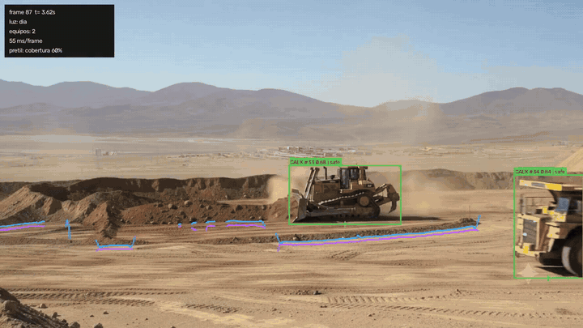
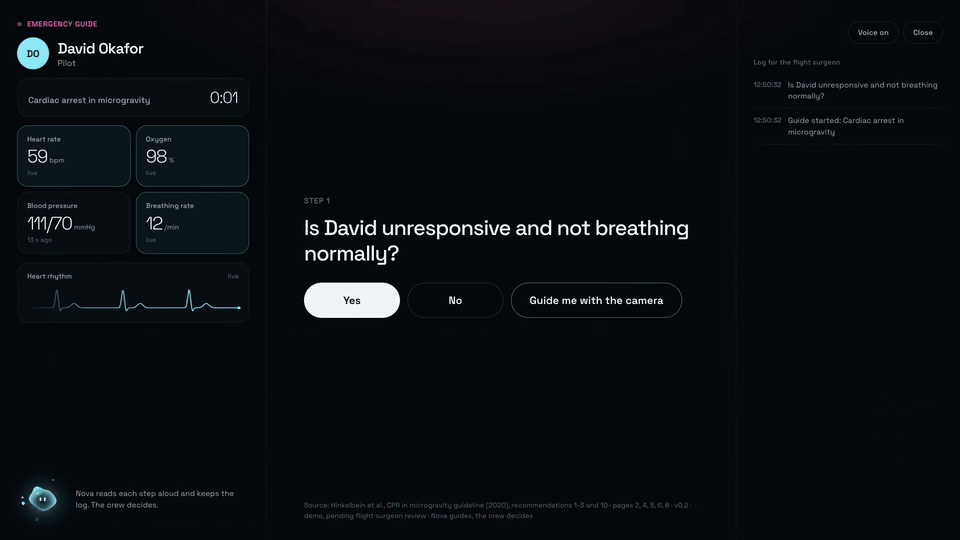
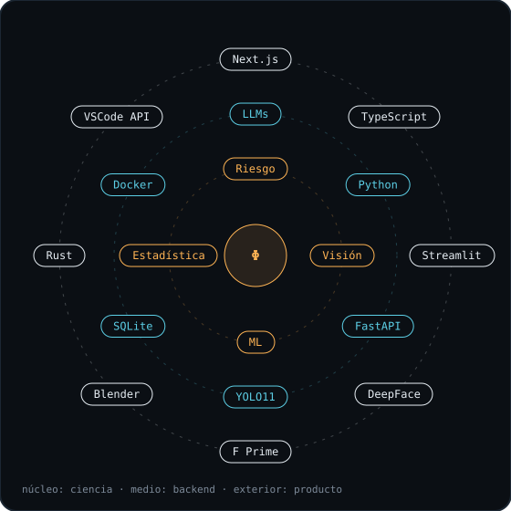
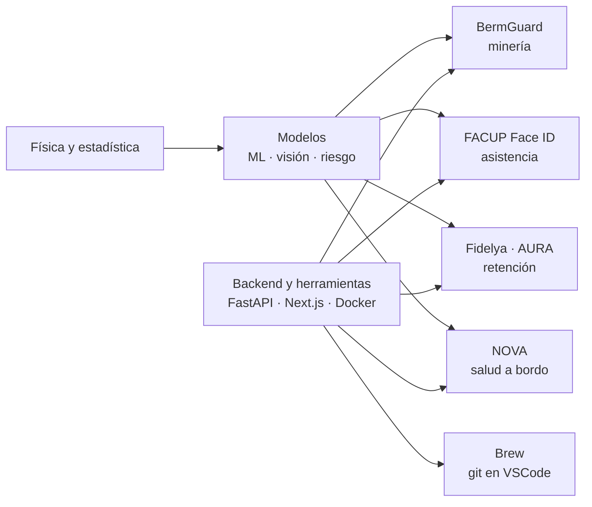

**Física aplicada a productos que se pueden medir: visión por computador, modelos de riesgo y software que llega a producción.**

## Qué hago

Soy ingeniero físico (Universidad Andrés Bello). Me muevo entre tres mundos: **modelar** (ML, visión, estadística), **validar** (riesgo de crédito en banca) y **construir** (backend, web y herramientas). Co-fundé **[Fidelya](https://fidelya.cl)**, donde soy CSO.

| | |
|---|---|
| 🔬 **Ciencia** | Visión por computador y ML aplicados a minería, asistencia y salud |
| 🏆 **Premio** | Ganador del **NASA International Space Apps Challenge 2026** con [NOVA](https://github.com/4mser/nova), un médico de a bordo para astronautas |
| 🏦 **Riesgo** | Validación de modelos de riesgo de crédito como consultor |
| 🚀 **Producto** | Fidelya: fidelización y retención con IA para locales físicos |

## Proyectos

<table>
<tr>
<td width="50%"></td>
<td width="50%"></td>
</tr>
<tr>
<td width="50%"></td>
<td width="50%"></td>
</tr>
</table>

> **FACUP Face ID** y **BermGuard** son los proyectos donde más medí. FACUP: 97.5% de acierto sin una sola falsa identificación en 735 verificaciones, comparando 4 modelos y 3 detectores. **BermGuard** destaca por cómo está medido: cifras con intervalos de confianza, umbral de operación explícito y decisiones corregidas con registro (ADR) cuando una medición mejor contradijo una anterior.

## En acción

<table>
<tr>
<td width="50%" align="center"> <b>BermGuard</b> · pretil y proximidad entre equipos (videos generados con IA)</td>
<td width="50%" align="center"> <b>FACUP</b> · panel del staff (sede demo, datos de prueba)</td>
</tr>
<tr>
<td width="50%" align="center"> <b>NOVA</b> · guía de RCP con realidad aumentada</td>
<td width="50%" align="center"> <b>NOVA</b> · protocolos de emergencia paso a paso</td>
</tr>
</table>

## Mi parte en NOVA: salud ocular con visión por computador

Diseñé el módulo que mira los ojos de la tripulación con la cámara del teléfono. Parte del Face Landmarker de Google (MediaPipe, 478 puntos con iris) y mide:

- la distancia margen-reflejo del párpado superior e inferior (MRD1 y MRD2, en versión normalizada por el diámetro del iris),
- cuántas veces y por cuánto tiempo parpadea la persona (parpadeo y PERCLOS),
- todo contra su propia línea base, y con abstención cuando la calidad de la imagen no alcanza.

Corre en CPU, con una mediana de ~8 ms por cuadro. Ahora lo estoy entrenando para detectar bostezos; esa parte es exploratoria. NOVA no es un dispositivo médico ni diagnostica: la salida es una alerta de seguimiento. El código está en un repositorio privado.

<table>
<tr>
<td width="50%"></td>
<td width="50%"></td>
</tr>
</table>

## Trayectoria

| | |
|---|---|
| **2023** | Práctica en el Instituto Milenio SAPHIR: detector de partículas alpha con fibras ópticas |
| **2024** | Ingeniero de ML en VASCOLAB (visión para túneles) y egreso de Ingeniería Física, UNAB |
| **Oct 2025** | Co-fundador y CSO de Fidelya; consultor de datos en riesgo de crédito |
| **2026** | Visión computacional y ML en B&N Solutions |
| **Nov 2026** | 🏆 Ganador del NASA International Space Apps Challenge con NOVA |

## Divulgación

Escribo cuadernos de divulgación científica para [B&N Solutions](https://bnsolutions.cl): física, tiempo y entropía, con experimentos interactivos como el efecto mariposa. Las simulaciones del laboratorio son abiertas en [`bn-lab-simulations`](https://github.com/4mser/bn-lab-simulations): 40 experimentos de física y matemáticas para la web.

## Stack, en órbita

## Cómo encaja todo

<b>🧪 Laboratorio: análisis y experimentos</b>

 

| Repo | Qué es |
|---|---|
| [`widget-git` (Brew)](https://github.com/xSempiternus/widget-git) | Widget de VSCode tipo cafetería para check, pull, commit y push de git |
| [`fastapi-sandbox`](https://github.com/xSempiternus/fastapi-sandbox) | Laboratorio de APIs REST con FastAPI, Pydantic y frontend |
| [`Exploratory-analisis-using-kmeans-of-instacart-data`](https://github.com/xSempiternus/Exploratory-analisis-using-kmeans-of-instacart-data) | Segmentación de clientes con k-means |
| [`Project1-PredictingBitcoinPrices`](https://github.com/xSempiternus/Project1-PredictingBitcoinPrices) | Predicción de precio con ML |
| [`climate-change-analysis.`](https://github.com/xSempiternus/climate-change-analysis.) | Análisis de cambio climático |
| [`Netflix-data-analysis`](https://github.com/xSempiternus/Netflix-data-analysis) | Análisis exploratorio de datos |
| [`voicecloning-linux`](https://github.com/xSempiternus/voicecloning-linux) | Clonación de voz en Linux |
| [`portafolio`](https://github.com/xSempiternus/portafolio) | Mi portafolio web |

**¿Hablamos?** &nbsp;·&nbsp; [LinkedIn](https://linkedin.com/in/nicolas-richardson-rojas) &nbsp;·&nbsp; [fidelya.cl](https://fidelya.cl) &nbsp;·&nbsp; [GitHub](https://github.com/xSempiternus) &nbsp;·&nbsp; [Hugging Face](https://huggingface.co/xSempiternus)

Escrito con señal, no con ruido.

