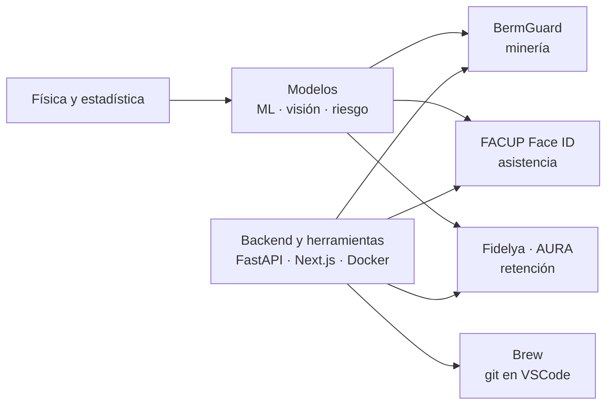

**Física aplicada a productos que se pueden medir: visión por computador, modelos de riesgo y software que llega a producción.**

## Qué hago

Soy ingeniero físico (Universidad Andrés Bello). Me muevo entre tres mundos: **modelar** (ML, visión, estadística), **validar** (riesgo de crédito en banca) y **construir** (backend, web y herramientas). Co-fundé **[Fidelya](https://fidelya.cl)**, donde soy CSO.

| | |
|---|---|
| 🔬 **Ciencia** | Visión por computador, ML, un paper publicado en arXiv sobre turbidez del agua |
| 🏦 **Riesgo** | Validación de modelos de riesgo de crédito como consultor |
| 🚀 **Producto** | Fidelya: fidelización y retención con IA para locales físicos |

## Proyectos

<table>
<tr>
<td width="50%"></td>
<td width="50%"></td>
</tr>
<tr>
<td width="50%"></td>
<td width="50%"></td>
</tr>
</table>

> **BermGuard** destaca por cómo está medido: cifras con intervalos de confianza, umbral de operación explícito y decisiones corregidas con registro (ADR) cuando una medición mejor contradijo una anterior.

## Stack, en órbita

## Cómo encaja todo

<b>🧪 Laboratorio: análisis y experimentos</b>

 

| Repo | Qué es |
|---|---|
| [`fastapi-sandbox`](https://github.com/xSempiternus/fastapi-sandbox) | Laboratorio de APIs REST con FastAPI, Pydantic y frontend |
| [`Exploratory-analisis-using-kmeans-of-instacart-data`](https://github.com/xSempiternus/Exploratory-analisis-using-kmeans-of-instacart-data) | Segmentación de clientes con k-means |
| [`Project1-PredictingBitcoinPrices`](https://github.com/xSempiternus/Project1-PredictingBitcoinPrices) | Predicción de precio con ML |
| [`climate-change-analysis.`](https://github.com/xSempiternus/climate-change-analysis.) | Análisis de cambio climático |
| [`Netflix-data-analysis`](https://github.com/xSempiternus/Netflix-data-analysis) | Análisis exploratorio de datos |
| [`voicecloning-linux`](https://github.com/xSempiternus/voicecloning-linux) | Clonación de voz en Linux |
| [`portafolio`](https://github.com/xSempiternus/portafolio) | Mi portafolio web |

**¿Hablamos?** &nbsp;·&nbsp; [fidelya.cl](https://fidelya.cl) &nbsp;·&nbsp; [GitHub](https://github.com/xSempiternus)

Escrito con señal, no con ruido.

