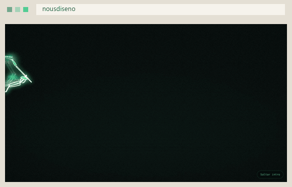
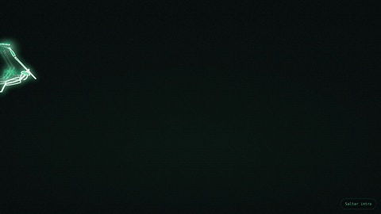
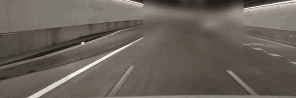
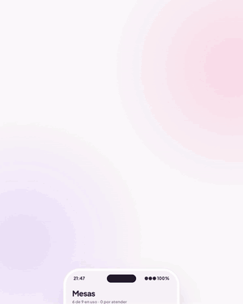
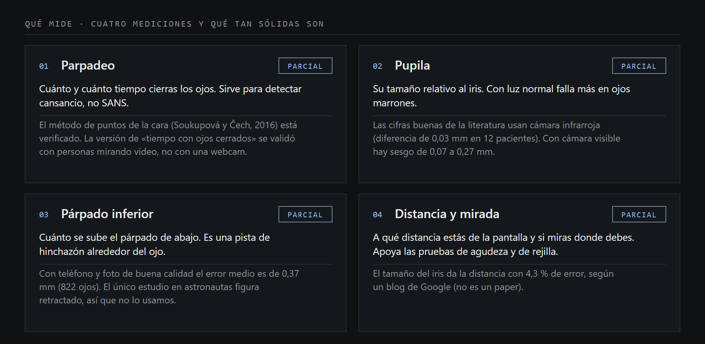
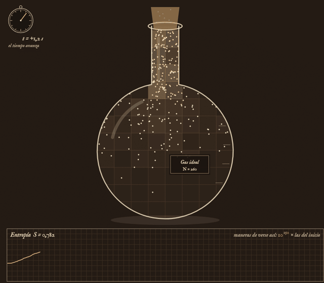

La intro de la página de <b>Nous Diseño</b>: un monito con boina que escribe el nombre del estudio con un pincel. La dibujé en Canvas, sin librerías.

# Nicolás Richardson

**Ingeniero físico. Mido cosas con visión por computador y las cuento con diseño web.**

[B&N Solutions](https://www.bnsolutions.cl) · [Fidelya](https://fidelya.cl) · [LinkedIn](https://linkedin.com/in/nicolas-richardson-rojas) · [Hugging Face](https://huggingface.co/xSempiternus)

---

Soy ingeniero físico (Universidad Andrés Bello). Entreno modelos de visión y de riesgo, y también hago la parte que se ve: sitios, animaciones y herramientas. Co-fundé **[Fidelya](https://fidelya.cl)**, donde soy CSO; trabajo en visión computacional y ML en **[B&N Solutions](https://www.bnsolutions.cl)** y como consultor de datos en **Management Solutions**.

🏆 En noviembre de 2026 gané el **NASA International Space Apps Challenge** con [NOVA](https://github.com/4mser/nova), un médico de a bordo para astronautas.

## Lo que hago

<table>
<tr>
<td width="50%" valign="top">

### 🔬 Visión por computador y modelos

- **Minería:** segmentar el pretil de seguridad de un botadero y vigilar la distancia entre equipos.
- **Asistencia:** reconocimiento facial en escuelas de fútbol.
- **Infraestructura:** filtraciones en túneles con YOLO sobre cámaras de seguridad.
- **Salud:** parpadeo y fatiga con la cámara del teléfono.
- **Banca:** validación de modelos de riesgo de crédito.

</td>
<td width="50%" valign="top">

### 🎨 Web, animación y producto

- **Sitios y animación** para estudios de diseño, como Nous Diseño.
- **Fidelya:** fidelización con IA para locales gastronómicos.
- **Videos** de producto y divulgación con AMBAR Studio.
- **Mascotas y escenas 3D** en Blender.
- **Divulgación científica** con simulaciones interactivas.

</td>
</tr>
</table>

## Proyectos

<table>
<tr>
<td width="50%" align="center" valign="top">
 
<b>Nous Diseño</b> · sitio web 
Portafolio de un estudio de diseño, con la intro animada del monito. HTML, JS y Canvas 2D, sin librerías.
</td>
<td width="50%" align="center" valign="top">
 
<b><a href="https://github.com/xSempiternus/BermGuard">BermGuard</a></b> · minería 
Segmenta el pretil, detecta CAEX y maquinaria, y evalúa la proximidad entre equipos. Docker. Videos generados con IA.
</td>
</tr>
<tr>
<td width="50%" align="center" valign="top">
 
<b><a href="https://github.com/xSempiternus/Facial-Recognition-FACUP">FACUP Face ID</a></b> · asistencia 
97,5% de acierto y cero falsas identificaciones en 735 verificaciones, comparando 4 modelos y 3 detectores. Datos de prueba.
</td>
<td width="50%" align="center" valign="top">
 
<b><a href="https://github.com/4mser/nova">NOVA</a></b> · ganador NASA Space Apps 2026 
Médico de a bordo para astronautas. Mi parte: el módulo de salud ocular (más abajo).
</td>
</tr>
<tr>
<td width="50%" align="center" valign="top">
 
<b><a href="https://www.bnsolutions.cl/filtraciones-tuneles">Filtraciones en túneles</a></b> · YOLO 
El modelo marca filtraciones sobre video real. Vehículos difuminados y señalética recortada.
</td>
<td width="50%" align="center" valign="top">
 
<b><a href="https://fidelya.cl">Fidelya</a></b> · retail y gastronomía 
Carta con QR, club de puntos, app para el equipo de sala y AURA, que recomienda y recupera clientes.
</td>
</tr>
</table>

> **FACUP** y **BermGuard** son donde más medí. En BermGuard hay cifras con intervalos de confianza, un umbral de operación explícito y decisiones corregidas con registro (ADR) cuando una medición mejor contradijo una anterior.

## Con más detalle

<b>Filtraciones en túneles: YOLO sobre cámaras de seguridad</b>

 

Los túneles viales urbanos se filtran, y hoy se inspeccionan a ojo. Si ya hay cámaras grabando las 24 horas, ¿por qué no enseñarles a mirar también las filtraciones? Entrené un detector YOLO con ejemplos etiquetados a mano, en tres niveles de severidad (leve, severa y crítica), y lo corrí sobre video real de cuatro tramos, uno de cada cinco cuadros. El resultado es una lista ordenable con el minuto, la posición, la severidad y la confianza de cada detección.

- **76%** de las detecciones son humedad leve, **23%** severas y **menos del 1%** críticas.
- Es un prototipo de investigación: las detecciones son brutas y **aún no se validan contra un conteo humano**, así que no declaro una precisión. Una misma filtración puede aparecer en varios cuadros.
- Artículo de divulgación: [Detección de filtraciones en túneles con YOLO](https://www.bnsolutions.cl/filtraciones-tuneles).

<b>Fidelya: lo que diseñé y construí como CSO</b>

 

- **AURA Analytics:** un sistema MCP sobre LLMs locales (Ollama) que detecta clientes en riesgo de abandono y sugiere campañas.
- **Chatbot de postventa con RAG** para los dueños de locales.
- **Content Studio:** un orquestador que combina un LLM y una API de imágenes para producir reels y publicidad con el estilo visual de la marca.
- **Módulo de validación y QA** para monitorear sesiones y errores, y un generador de propuestas comerciales por rubro.
- **Mascota 3D en Blender** y videos promocionales con AMBAR Studio.

<b>NOVA: salud ocular con visión por computador</b>

 

Diseñé el módulo que mira los ojos de la tripulación con la cámara del teléfono. Parte del Face Landmarker de Google (MediaPipe, 478 puntos con iris) y mide:

- la distancia margen-reflejo del párpado superior e inferior (MRD1 y MRD2, normalizada por el diámetro del iris),
- cuántas veces y por cuánto tiempo parpadea la persona (parpadeo y PERCLOS),
- todo contra su propia línea base, y con abstención cuando la calidad de la imagen no alcanza.

Corre en CPU, con una mediana de ~8 ms por cuadro. Ahora lo estoy entrenando para detectar bostezos; esa parte es exploratoria. NOVA no es un dispositivo médico ni diagnostica: la salida es una alerta de seguimiento. El código está en un repositorio privado.

<b>Divulgación: «La flecha del tiempo»</b>

 

Tengo cuadernos de divulgación en preparación, aún sin publicar. Este es uno, con tres experimentos interactivos. En el primero, un gas simulado molécula por molécula llena un frasco y, al invertir el tiempo, cada molécula recorre su camino al revés y el gas vuelve al cuello, mientras la curva de entropía sube y baja.

Borrador · simulación basada en <a href="https://github.com/4mser/bn-lab-simulations">BN Lab Simulations</a> (MIT)

<b>BermGuard: el detector propio</b>

 

Dos máquinas, dos cajas. El modelo COCO las juntaba en una.

<b>Trayectoria</b>

 

| | |
|---|---|
| **2023** | Práctica en el Instituto Milenio SAPHIR: detector de partículas alpha con fibras ópticas |
| **2024** | Ingeniero de ML en VASCOLAB (YOLO para detectar filtraciones en túneles) y egreso de Ingeniería Física, UNAB |
| **Oct 2025** | Co-fundador y CSO de Fidelya; consultor de datos en riesgo de crédito |
| **2026** | Visión computacional y ML en B&N Solutions |
| **Nov 2026** | 🏆 Ganador del NASA International Space Apps Challenge con NOVA |

<b>Stack y laboratorio</b>

 

`Python` `PyTorch` `OpenCV` `Hugging Face` `TensorFlow` `FastAPI` `Docker` `Next.js` `NestJS` `MongoDB` `Rust` `Blender` `Canvas`

| Repo | Qué es |
|---|---|
| [`widget-git` (Brew)](https://github.com/xSempiternus/widget-git) | Widget de VSCode tipo cafetería para check, pull, commit y push de git |
| [`fastapi-sandbox`](https://github.com/xSempiternus/fastapi-sandbox) | Laboratorio de APIs REST con FastAPI, Pydantic y frontend |
| [`Exploratory-analisis-using-kmeans-of-instacart-data`](https://github.com/xSempiternus/Exploratory-analisis-using-kmeans-of-instacart-data) | Segmentación de clientes con k-means |
| [`Project1-PredictingBitcoinPrices`](https://github.com/xSempiternus/Project1-PredictingBitcoinPrices) | Predicción de precio con ML |
| [`climate-change-analysis.`](https://github.com/xSempiternus/climate-change-analysis.) | Análisis de cambio climático |
| [`Netflix-data-analysis`](https://github.com/xSempiternus/Netflix-data-analysis) | Análisis exploratorio de datos |
| [`voicecloning-linux`](https://github.com/xSempiternus/voicecloning-linux) | Clonación de voz en Linux |
| [`portafolio`](https://github.com/xSempiternus/portafolio) | Mi portafolio web |

---

**¿Hablamos?** · [B&N Solutions](https://www.bnsolutions.cl) · [LinkedIn](https://linkedin.com/in/nicolas-richardson-rojas) · [fidelya.cl](https://fidelya.cl) · [Hugging Face](https://huggingface.co/xSempiternus)

